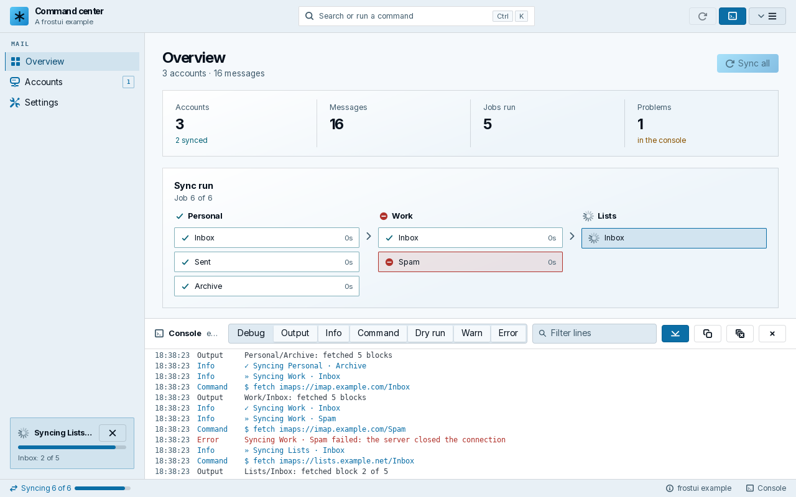

<!-- readme-kind: library -->
# frostui

[](https://pkg.go.dev/github.com/frostyard/frostui)

frostui is a Go module that gives desktop apps on [MyGo](https://github.com/egoist/mygo) a command-center window and the pieces to fill it, for frostyard's apps: ChairLift, Frostmail and Frostnotes.

**Status:** pre-release. Until v1, a minor version may change the API, and each change is listed in the [design doc](docs/design/frostui.md#api-changes).

**Documentation:** [pkg.go.dev/github.com/frostyard/frostui](https://pkg.go.dev/github.com/frostyard/frostui)



## What it does

| Package | What it gives you |
| --- | --- |
| `frostui` | The shell (top bar with a command palette, rail, console and status bar), a frame without the rail for apps made of panes, a serial job queue, a command table behind keys, menus and the palette, a source list, a settings layout, an allow-listed opener, dialogs, cards, rows, charts, and the desktop's icons (with an embedded set) and accent. |
| `frostuitest` | A stand-in for the UI thread, so tests run what workers post without a window. |

It builds without CGO for Linux, Windows and macOS on amd64 and arm64, and for js/wasm. The freedesktop parts (app ID, icon theme, launching desktop apps) work on Linux and fall back elsewhere.

## Requirements

- Go 1.27.
- At run time, what MyGo needs: GTK 3, libepoxy and Pango on Linux.
- For the tests: Pango and cairo, and no display.

## Install

```sh
go get github.com/frostyard/frostui
```

## Use

```go
import (
	"log"

	"github.com/egoist/mygo"
	"github.com/egoist/mygo/ui"

	"github.com/frostyard/frostui"
)

func main() {
	shell := &frostui.Shell{Brand: frostui.Brand{Name: "Notes"}, Selected: "all"}
	nav := []frostui.NavSection{{Title: "Notebooks", Items: []frostui.NavItem{
		{ID: "all", Title: "All notes", Icon: "folder"},
	}}}
	mygo.App.WhenReady(func() {
		mygo.NewWindow(mygo.WindowOptions{
			Title: "Notes", Width: 1100, Height: 720, TitleBarStyle: mygo.TitleBarHidden,
			Content: ui.View(func(c *ui.Context) {
				shell.View(c, frostui.Frame{
					Nav:     nav,
					Content: func() { frostui.PageHeader(c, "All notes", "3 notes", nil) },
				})
			}),
		})
	})
	if err := mygo.App.Run(); err != nil {
		log.Fatal(err)
	}
}
```

[examples/commandcenter](examples/commandcenter) adds the palette, the console, the job queue and the status bar: `go run ./examples/commandcenter`. [examples/threepane](examples/threepane) is a window of panes with no rail: `go run ./examples/threepane`. [examples/sourcelist](examples/sourcelist) shows a source list, a command table, a lazy palette source and a settings dialog: `go run ./examples/sourcelist`.

## Develop

```sh
mise install   # golangci-lint and Node; Go comes from go.mod
make ci        # what CI runs
```

Design and invariants: [docs/design/frostui.md](docs/design/frostui.md).

## Where to go next

- [AGENTS.md](AGENTS.md): the rules for agents and contributors.
- [docs/README.md](docs/README.md): the decisions, designs, specs and plans.
- [SECURITY.md](SECURITY.md): report a vulnerability privately.
- [LICENSE](LICENSE): MIT. The embedded icons are Lucide's, under the ISC license: [NOTICE](NOTICE), [icons/LICENSE](icons/LICENSE).
