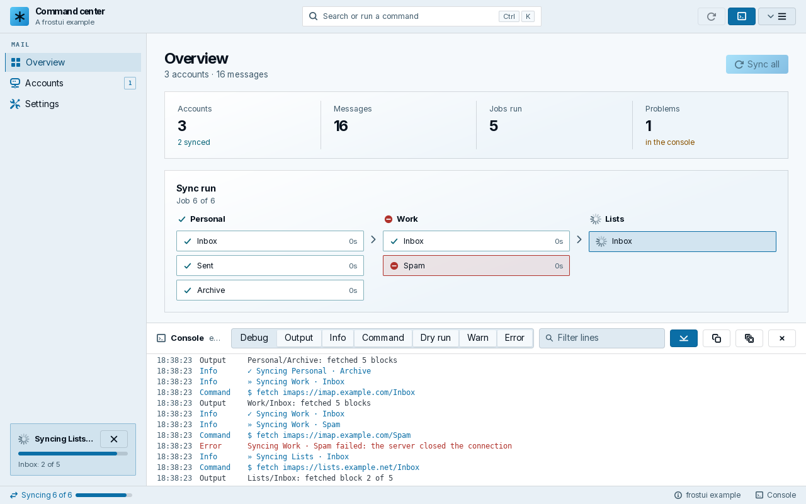
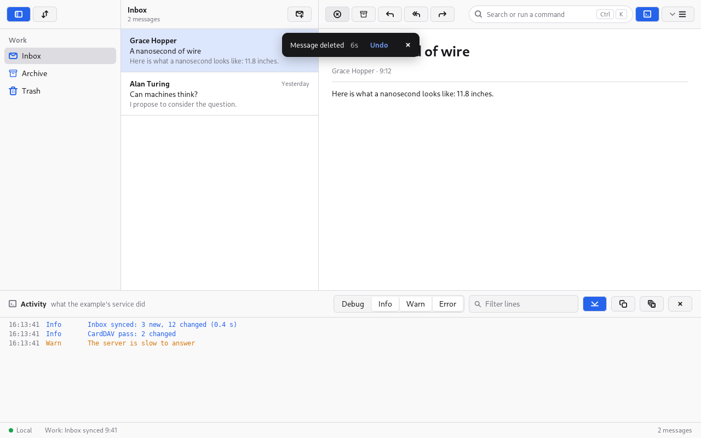
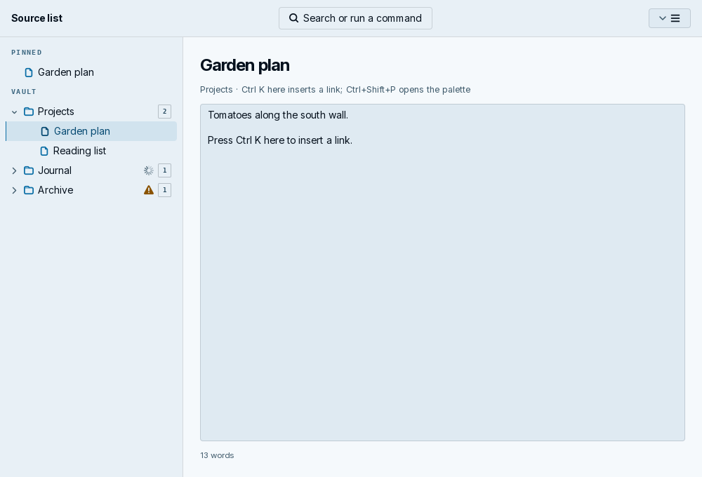

# frostui: frostyard's desktop UI kit

Living document. Rationale: [ADR-0004](../adr/0004-extract-the-ui-kit-into-its-own-module.md), [ADR-0005](../adr/0005-build-everywhere-with-freedesktop-parts-behind-build-tags.md), [ADR-0006](../adr/0006-a-frame-without-the-rail.md), [ADR-0007](../adr/0007-embed-a-lucide-icon-set-as-the-last-fallback.md), [ADR-0008](../adr/0008-open-behind-allow-lists-and-let-editors-keep-their-keys.md), [ADR-0009](../adr/0009-the-top-bars-end-belongs-to-the-window.md), [ADR-0010](../adr/0010-keep-only-a-mailto-links-addressees-subject-and-body.md).
Contracts: [spec: API stability](../specs/api-stability.md).
Built in: [roadmap](../plans/roadmap.md), [the Frostyard look](../plans/frostyard-look.md).

## Overview

`github.com/frostyard/frostui` is a thin layer over MyGo's native UI package
(`github.com/egoist/mygo/ui`) that gives frostyard's desktop apps one look
and one set of behaviors. It came out of ChairLift's `internal/frostui`
([ADR-0004](../adr/0004-extract-the-ui-kit-into-its-own-module.md)). Five
apps build their windows from it: ChairLift (frostyard/chairlift), Frostmail
(frostyard/frostmail), Frostnotes (frostyard/frostnotes), the Firn GUI
installer (the `gui/` module of frostyard/firn) and the Pocket client
(frostyard/pocket). It builds without CGO
for Linux, Windows, macOS and js/wasm
([ADR-0005](../adr/0005-build-everywhere-with-freedesktop-parts-behind-build-tags.md)).

```
app state ──► Shell.View(c, Frame{…}) ──► top bar · rail · page · console · status bar
                    │                          ▲
app pages ──► Card, Figures, CommandRow, …     │ Window.Update (post)
                                               │
app changes ──► Jobs.Enqueue(Job) ──► Run on a goroutine ──► Done on the UI thread
                         └──► Console (start, output, end) ──► ConsoleView
```



The picture is `examples/commandcenter` drawn by its snapshot test
(`make snapshot`).

## Design

### The command-center shell

`Shell` (`shell.go`) is the window: a top bar (brand, a field that opens the
command palette, the app's buttons, a main menu), a left rail of pages with
counts and a footer, the page area (scrolled, padded, at most 1320 DIPs
wide), an optional console split under it, and a status bar of clickable
items. The app keeps one `Shell` in its state and calls
`Shell.View(c, Frame{…})` from its root view every frame; the `Frame` says
what goes where: `Nav` (sections of `NavItem`, with a `Badge` and a
`Shortcut` for the tooltip), `Actions`, `Menu`, `RailFooter` (the running
job's `JobCard`, a host card), `Content` (the selected page), `Commands`,
`Status` and `StatusEnd`, and `ConsoleData`. `Shell.Selected` is the rail's
page; the app reads it to pick `Content` and writes it to navigate.

In a narrow window the brand and the bar's trailing controls (`Actions`,
the console's button, the main menu) keep their size, and the palette field
gives way: from 380 DIPs down to 180, then to its compact button
([ADR-0009](../adr/0009-the-top-bars-end-belongs-to-the-window.md), see
[narrow bars](#narrow-bars)).

The shell binds Ctrl K (palette) and, with a console, Ctrl J (console), and
draws the shell's `Dialogs`, its `Info` dialog and the palette over the
page. An app binds its own shortcuts with `c.OnWindowShortcut` and lists
them with `ShortcutsBody` in `Info`.

**The pattern** an app follows: a rail of the places it has (pages,
mailboxes, notebooks), the palette for every command, including "Go to"
each page, the console as an activity log of what the app runs, the job
queue for every change, and the status bar for the state of the current
run. `examples/commandcenter` is the reference: a pretend mail sync with an
overview, an accounts page of `CommandRow`s and a settings page of
`SwitchRow`s.

### The frame without the rail

`paneshell.go`
([ADR-0006](../adr/0006-a-frame-without-the-rail.md)): `PaneShell` is the
window of an app whose content is its own panes. The app keeps one and calls
`PaneShell.View(c, PaneFrame{…})` every frame, under a hidden title bar as
`Shell` is: the top bar is the drag region and keeps clear of
`c.TitleBar()`'s room.



The picture is `examples/threepane` drawn by its snapshot test.

The top bar takes one of two shapes:

- **Segments.** `PaneFrame.Panes` draws panes, and each `Pane.Bar` is the
  part of the top bar over its pane, in the pane's own column, so it follows
  the pane's width exactly. A collapsed pane takes its segment with it. The
  bar's end (the palette field, `End`, the console's button and the main
  menu) is the window's, not the last pane's
  ([ADR-0009](../adr/0009-the-top-bars-end-belongs-to-the-window.md)): it is
  drawn once, above the segments and their separators, before the window
  controls, and the part of a segment under it is padding. It lies over the
  end of the last segment and, when the last pane is too narrow, over the
  segments before it.
- **A bar not split.** Without `Panes`, `Start` follows the toggle, the
  palette field is in the middle of the window, and `Content` draws the
  rest: full height, not scrolled, not padded.

Either way the frame owns the order every app shares: `SidebarPane` puts the
toggle at the far left (of `SidebarPanes`, or the shell's `Panes`);
`PaletteField`, the same widget everywhere; then `End`, the console's button
and the main menu (`Menu`) last before the window controls. Right to left
the order is mirrored, and the end is by the window controls at the left.
The status bar starts with `Connection`, then `Status`, and ends with
`StatusEnd`.

Ctrl K opens the palette, except inside a text editor: an element around the
focus that binds the key hears it first, and `PaneFrame.InEditor` keeps it
for an editor that cannot. Ctrl Shift P opens it from everywhere. With
`PaneFrame.Table` the [command table](#command-table) owns the shortcuts
instead, and `InEditor` is not read.

The console (`ConsoleData`) is a split under the panes, closed by default.
Ctrl J, the top bar's button and the palette's command toggle it;
`ConsoleCommand` is the command, added to the palette unless the app's
commands have its ID (`ConsoleCommandID`). Its separator takes the same
keys as a pane's, and `ConsoleHeight` is a plain value the app may save.
`ConsoleView.Title` names the pane ("Activity"), `Offered` limits its levels
(a level not offered has no toggle and shows no lines) and `EmptyNote` is
what it says while empty.

The shell draws the window's toasts as `TopToasts` does, under the top bar,
so an app does not call `TopToasts` (`ToastCloseLabel` names their close
button).

#### Narrow bars

The sidebar toggle and the trailing controls (`End`, the console's button,
the main menu) never shrink; the apps' items and the palette field give
way, so the main menu stays inside the window and clear of
`c.TitleBar()`'s room at any width
([ADR-0009](../adr/0009-the-top-bars-end-belongs-to-the-window.md)):

- Over segments, the panes' `Bar` items under the bar's end give way first.
  The field then fits the room the last segment has beyond the trailing
  controls, from 300 DIPs down to 160. With less, the field is drawn
  compact, and when even that end is wider than the last segment, it
  reaches over the segments before it, whose `Bar` items give way too.
- In a bar not split, the field shrinks first, staying in the middle, from
  380 DIPs down to 180; then `Start` gives way (it clips); then the field
  is drawn compact.
- The compact field is an icon button with the field's name ("Search or
  run a command"), its tooltip ("Command palette (Ctrl K)") and its key for
  assistive technology; a click opens the palette, as Ctrl K does. Being
  the same control in the same place of the shared order, it keeps the
  shared look better than moving the field to another segment would.

The bar reads the widths of the toggle, the trailing controls and its end
from the last frame, and asks for one more frame when one changes, as
`Panes` does with its room. The end of a bar of segments comes after the
panes in the order Tab moves the focus and assistive technology reads.
`TestPaneShellBarEndStaysInTheWindow`, `TestPaneShellPlainBarEndStaysInTheWindow`
and `TestShellBarEndStaysInTheWindow` (`barend_test.go`) keep the controls
inside the window, apart, and working.

### Panes

`panes.go`: `Panes.View(c, []Pane{…})` lays panes side by side. A `Pane` has
an `ID`, a `Label` (the region's and its separator's name), a `Width`, `Min`
and `Max`, `Collapsible`, `Bar` and `Content`. The first pane with no `Width`
takes the room left (the last pane when all have one).

A separator resizes the pane on its far side from the pane that takes the
room left. It is a `RoleSeparator` with `Range` (the pane's minimum, its
maximum in the room there is, and its width) and `Step`, and it takes the
arrows (`Panes.Step`, 16 DIPs, the way they point), Home and End; a double
click resets its pane. It takes 1 DIP of room and the pointer 3 DIPs either
side.

`Panes.Layout` is a `PaneLayout`, a plain struct of widths and collapsed
panes that the app saves and restores; widths out of bounds are clamped when
drawn. `Toggle` and `SetCollapsed` hide a `Collapsible` pane and ignore any
other ID, every ID before the first frame (a pane that starts collapsed is
set in `Layout`), and `Shown` says what shows. A narrow window first shrinks the panes in proportion to what
they have above their minimums, then hides `Collapsible` panes, the last
first and the one the app last showed after them; that is not saved. A
hidden pane is not built, so what it must remember lives in the app's state.

### Connection status

`connection.go`: `Connection` describes an app's link to its daemon.
`ConnectionStatus` is the status bar's item: a dot with "Local" or the host,
in the warning tone with the reason in its tooltip while `Reconnecting`, and
a button when `OnClick` is set. `ConnectingScreen` fills the window with what
it connects to, the reason, Retry (`OnRetry`) and Details (`OnDetails`), and
is its own drag region. A `PaneShell` draws it for the `Connecting` state, the
first try, with the main menu and the palette still there; `Reconnecting`
keeps the content.

### Action toast

`toasts.go`: `ShowActionToast(c, ActionToast{…})` shows a toast with an action
and, with `Countdown`, the seconds left, for Undo and Undo Send. Exactly one
of `OnAction` and `OnExpire` runs: `OnExpire` when the toast closes without
the action, by its time, its close button or `CloseToast`. Each call shows a
toast of its own, because MyGo replaces a toast of the same ID without
running its `OnClose`. Neither callback runs when the window closes while
the toast shows, so an app finishes the pending work on close. `TopToasts` draws the action only for these toasts:
others look as before. MyGo stops a toast's time while the pointer rests on
it.

### The coalescing waker

`waker.go`: `NewWaker(post, every)` returns a `Waker` whose `Wake`, safe from
any goroutine, posts an empty function at most once an interval.
`Window.Update` rebuilds the view on every call, so give a stream's notify
function `Wake`: `console.SetNotify(frostui.NewWaker(win.Update, 60*time.Millisecond).Wake)`.

### Command palette

`palette.go`: `Command{ID, Title, Group, Icon, Keys, Hint, Disabled, Reason,
Run}`. `Match` scores an ordered subsequence, ignoring case: word starts,
runs and a match at the start count more, and shorter texts win among
equals. `Filter` ranks by title and hint (a hint match counts 4 less) and,
with an empty query, keeps the commands in order, grouped by first-seen
group. Up, Down, Enter and Escape work in the field. Opening the palette
(`Show`) and changing the query select the first command and scroll the
list back to it, so the command Enter runs is the one shown highlighted,
never one scrolled off by an earlier opening. A chosen command runs
after the palette closes, before the page is built (`RunPending`), so a
command that changes the page or asks a question shows in the same frame.

### Job queue

`jobs.go`: `Jobs` runs `Job`s one at a time, in order, so two changes never
race. `Run` works on a goroutine with a cancelable context and a `Progress`
(`Set(fraction, status)`, coalesced so that at most one post waits;
`Log(level, …)` to the console under the job's `Source`); `Done` runs on the
UI thread with `Run`'s error. The queue counts batches (`Batch`: "Job 3 of
10"; a batch is every job queued since the queue was last idle), lists the
batch's jobs in queue order (`BatchJobs`), finds the job of an item by
`Source` and `Key`, and calls `OnIdle` with the batch when the last job
ends. `Find` returns the newest job of the pair that waits or runs, in
`Enqueue` order (the newest queued one, else the running one), else the
newest that ended in the current batch; `Pending` reports whether any job
of the pair waits or runs, so a newer job that `CancelAll` dropped does not
hide an `Unstoppable` one of the same pair that still runs. It recovers a
panic in `Run` as the job's error and logs each job's start ("» title"),
success ("✓ title"), cancel and failure to the console. `CancelAll` drops
the queued jobs (their `Done` gets `context.Canceled`) and cancels the
running one, except an `Unstoppable` job, which finishes and reports its
own result while the queue stays busy (`Stopping`, `CanStop`). A job that
finished despite a cancel keeps its own result. `Duration` formats a job's
time ("1m 03s") and `RunSummary` how a batch ended ("9 done · 1 failed").

### Console

`console.go`, `consoleview.go`: `Console` is a thread-safe ring buffer of
lines with levels (debug, output, info, command, dry run, warn, error),
counts of warnings and errors since the last `Clear`, and a notify function
called after each `Add` from the adding goroutine. `Lines(levels, query)`
filters by level and by text or source; `Text` renders lines for the
clipboard. `Console.Writer` adapts it as a `log` output, with an optional
`Classify` that picks the level of each line: a write of several lines is
split first, so its lines can differ in level and count as warnings or
errors one by one. The writer keeps no partial line between writes (a
write without a final newline is a line of its own) and does not strip
the standard logger's timestamp. `ConsoleView` is the pane: filters by level
(`DefaultLevels` hides debug) and text, follow, copy, clear and close; its
`Subtitle` follows the title ("every command the app runs, as it runs"
when empty).

### Dialogs

`dialogs.go`: `Dialogs.Ask(Confirm{…})` queues confirmations and shows them
one at a time (a destructive action in the danger color, a `Note` with a
password icon for administrator authentication). `Info` shows content
dialogs; `ShortcutsBody` and `AboutBody` build the usual two. `CodeDialog`
shows text exactly as it is (a report before it is sent) in a scrollable
monospaced box with Cancel and an action, and holds no state of its own.

### Building blocks, rows and visualizations

- `components.go`, `text.go`: `Card`, `CardHeader`, `PageHeader`, `Section`
  and `SectionHeader` (`SectionHead`: icon, title, note, aside, `Quiet`),
  `Figures`, `Pill`, `IconPill`, `ColorPill`, `DotPill`, `SquareAvatar` and
  `Initials`, `IconTile`, `IconButton`, `LabeledButton`, `Banner` (and
  `BannerClose`, which names its close button), `Empty`,
  `Loading`, `Problem`, `KeyValues` (with `KeyValuesStyle`), `PillTabs`,
  `SoftSelection`, `RowDivider`, `Kbd`/`Shortcut`, and the text styles
  `Title`, `Heading`, `Strong`, `Body`, `Muted`, `Caption`, `Mono`, `Toned`.
- `rows.go`: `JobStatus(c, RowStatus{…})` draws a row's state at its end (a
  spinner while queued or running, a check, an error, or a note; `Compact`
  for dense rows), `VersionChange` ("1.2 → 1.3"), `CommandRow` (icon tile,
  title with an optional "admin" pill, the command line in monospace, a
  132 DIP status cell and a 72 DIP action cell), `StepTile`, `SwitchRow`
  (returns its switch), `DisclosureCard` (opens in the frame of the click)
  and `TileGrid`.
- `wizard.go`, `toasts.go`: `Hero`, `StepDots` (a progress for screen
  readers, "2 / 5") and `TopToasts` (at the top of the window, each with a
  close button named by the app).
- `viz.go`, `pipeline.go`: `LiveChart` (0–100 series, smoothed), `Legend`,
  `Gauge`, `SegmentBar`, `ToggleTile`, `Pipeline` (stages of steps with
  states; its list is named "Pipeline", and an app chains `Label` to name
  its run), `JobCard` (the rail's running job with a Stop button) and
  `StateOf` (a job's state as a step's).

- `diff.go`: `DiffView` is a native read-only unified diff. Keep it in window
  state and call `SetPatch` with the response text, then `View` with a height
  or `Grow`. It parses only changed text, virtualizes rows, wraps long lines
  and shows old/new line numbers with signed additions and removals. Metadata
  and binary notices remain literal text. The caller owns loading, empty and
  error states, file selection, and any file operations.

### Command table

`commandtable.go`: one `CommandTable` holds an app's commands and drives the
keys, the palette, the menus and the shortcuts dialog, so a command has one
ID, title, group, keys and enabled rule. An entry is the palette's own
`Command`, with three more fields: `Bindings []KeyBinding` (the keys),
`Enabled func() (ok bool, reason string)` (decides `Disabled` and `Reason`
as it is read) and `Checked func() bool` (a menu item's check mark);
`Unlisted` keeps it out of the palette. `Command.Resolve` applies `Enabled`
and fills `Keys` from the first binding, which bridges a table's command to
the palette and to anything else that reads `Command`.

- `Bind(c)` binds the keys of the enabled commands at the window, every
  frame. The first enabled command takes a key two commands share.
  `BindKeys(c, keys, run)` binds keys outside the table by the same rule.
- `Commands()` fills the palette; `Menu(ids...)` returns a function for
  `Frame.Menu`, `ui.MenuButton`, `Element.ContextMenu` and
  `Element.PopoverMenu` ("" is a separator; nest with `m.Submenu`);
  `MenuItem(m, id)` adds one item; `Shortcuts()` feeds `ShortcutsBody`, a
  line per key; `Tooltip(id)` writes "Reply (Ctrl+R)".
- `Frame.Table` and `PaneFrame.Table` wire a table into a frame, which
  binds it and lists it in the palette after the frame's `Commands`. The
  frame adds the palette's command (`Palette.Command`, on `PaletteBindings`)
  and the console's (`ConsoleCommand`, Ctrl J) to the table, and binds no
  palette or console key of its own, so a key is never bound twice:
  a command of the app's with the same ID stays, and one that binds the same
  key keeps it. While `PaneShell`'s connecting screen covers the window the
  console's command leaves the table. Without a table a frame binds its keys itself,
  as before (`PaneFrame.InEditor`).

**How a key yields to an editor.** MyGo decides a key in this order: a text
input takes what it types and edits with (letters, Backspace, the arrows,
Ctrl+C), then an element around the focus that bound the key
(`Element.OnShortcut`), then overlays, then the window. An editor's own key
handler (`Element.OnTextKey`, or `Element.HandleInput`, which MyGo's code
and rich text editors use) sees a key only when no shortcut claims it, and
a window shortcut claims it. So a window that bound Ctrl K would take it
from the editor. The
table therefore does not register a key while its scope says to step aside,
and the key goes to the editor. `KeyBinding.Scope` says where a key works:

| Scope | Works | For |
| --- | --- | --- |
| `OutsideEditors` (zero value) | everywhere but a text editor | Ctrl K, which is Insert Link there |
| `OutsideText` | only where nothing takes text | a key a one-line field should keep |
| `Everywhere` | wherever the focus is | Ctrl+Shift+P, Ctrl+N |

`c.FocusTakesText()` tells that text is being typed, but not whether into an
editor or a one-line field, so `CommandTable.Editing` names the editors. It
is a function of the window's `Context`, usually `c.FocusWithin(handle)` over
a `ui.Handle` bound to the editor, which reads the focus whatever the build
order. Left nil, any element that takes text counts, so that a key never
goes past a field. An element that binds the key itself comes first in
every scope. A table binds the keys of one window; give each its own. The
rule is [ADR-0008](../adr/0008-open-behind-allow-lists-and-let-editors-keep-their-keys.md).

### Palette sources

`palette.go`: besides the commands, a `Palette` finds what its `Sources` find
(notes by name, mailboxes, messages). A `PaletteSource` has an `ID`, a
`Title` that heads its results, a `Placeholder`, a `Limit` applied while
other sources show too, and `Query`. The palette calls `Query` on the UI
thread only while it shows the source, once as it opens and once per new
query, never per frame. Commands come first, as the source
`PaletteCommands`, then each source in order, in sections: an item's `Group`
heads it, or the source's `Title`. A source ranks its own results, with
`Match` or `Rank`, which reads no UI state and so runs on a worker.

A source answers with `PaletteQuery.Reply`, at once or later: a worker posts
it through `Window.Update`, since `Reply` belongs to the UI thread. A reply
to a query the user typed past, or to a closed palette, is dropped, and
`PaletteQuery.Context` is canceled then so the worker can stop. A source may
reply several times. The last results stay while a new query is out, so the
list does not flicker, and the footer says "Searching…". The choice follows
its item as results come. `Show` opens every source; `ShowSource(id)` opens
one alone (Ctrl O on notes, Ctrl P on `PaletteCommands`). `PaletteItem.RunWith`
gets the modifiers held with Enter or the click (Ctrl+Enter, Ctrl+Alt+Enter,
Alt+Enter, Shift+Enter).

### Source list

`sourcelist.go`: `SourceList[K]` is a sidebar of items in a tree on
`ui.Outline`, which builds only the rows in view (`ui.Tree` builds every
item), so 10,000 notes cost what 20 do. `View(c, sections)` draws
`SourceSection`s; `Children` and `Row` describe the tree. A row's identity
is its section and item, so one mailbox can show under Favorites and under
its account.

- **Sections** are outline branches marked as list headers: never chosen,
  pinned while their rows scroll, and a click hides their items.
- **Rows** (`SourceRow`): icon, title, `Tag`, `Busy` (spinner), `Alert`
  (warning sign with a tooltip), `Count`, `Dim`, and `Tooltip`, what
  hovering the row shows (the alert's own tooltip shows over its sign).
- **Selection:** one item, by a click, Up, Down, Home, End and typing;
  Left and Right close, open and move as in any tree. `Selected`, `Select`
  (opens the way to the item and scrolls to it), `OnSelect`, and
  `OnActivate` for Enter and a double click. A choice survives its section
  closing and is forgotten when its item goes. `OnClick` reports explicit
  row clicks. When `OnActivate` is nil, Enter, Cmd+Enter, Cmd+Alt+Enter
  and the second click of a double click also call `OnClick`. With
  `OnActivate` set, those activation events call only `OnActivate`.
  `OnMiddleClick` runs when a middle-button press on a row ends, not
  canceled, with the pointer over the same row, without changing
  selection. The list keeps the press in its own fields, and the row's
  `ObserveInput` tells, by MyGo's hit test, that the release is over it,
  so a header pinned over the row takes it; no row makes a `ui.Handle`.
  `OpenGeneration` identifies changes to the expanded items.
- **Menus and drops:** `Menu` builds a row's context menu; `DropOn[K, T]`
  makes rows take values of type `T`, highlights a row that accepts, and
  passes the modifiers held (Ctrl or Alt to copy); `DragItems` makes rows
  drag.
- **Rename:** `Rename`, `CanRename`, F2 or `StartRename`. Enter or the focus
  leaving keeps the name, Escape gives up. MyGo's `EditableText` has no way
  to start from a menu, so the list draws its own field.
- **Assistive technology** sees a tree. A tree item is one accessible name
  with no elements of its own, so the name carries the state: "Inbox, 12",
  or the title and `SourceRow.Spoken`.

The rows use `OutlineState.Prefix` only to take the `OutlineRow`, and call
its `Arrow` inside their own row, so that the whole width takes menus and
drops, and a header's whole title opens and closes it.



The picture is `examples/sourcelist` drawn by its snapshot test.

### Settings layout

`settings.go`: `Settings` draws a list of `SettingsPage`s at the left and the
chosen page's `SettingsGroup`s, cards of `Setting` rows, at the right, filling
a window (`View`) or in a dialog (`Dialog`, `Show(id)`). A `Setting` has a
title, a subtitle and one control: `Switch` (`SwitchRow`), `Choice`
(`SelectRow`), `Text` (`TextRow`), `Number` (`NumberRow`), `Control` (the
app's) or a read-only `Value`. A group's `Values` draw with `KeyValues`, and
a page's `Body` draws what is not a row, as a list of accounts. With
`Search`, a field finds settings on every page by the words of the query in
their title, subtitle, keywords or value; whole words rather than `Match`'s
scattered letters, which nearly any sentence would hold. A match on a page's
title or `Keywords` shows the whole page.

### Opener

`opener.go`: `Opener` opens what comes from outside the app (a link in a
message, an attachment) with the system's handlers, through MyGo's
`Shell.OpenExternal` and `Shell.OpenPath`, on every platform. It holds no
state and is safe from any goroutine; it waits for the system, so call it
from a worker. Anything not allowed returns an error wrapping
`ErrNotAllowed`; `CheckURL` and `CheckFile` answer without opening.

- `OpenURL`: the scheme must be in `Schemes` (http, https and mailto by
  default); http and https need a host; spaces and control characters are
  refused; `file:` is refused even when listed. A mailto link opens as
  `SanitizeMailto` returns it, whatever `Schemes` lists, and one left with
  no address and no field names nothing and is refused.
- `SanitizeMailto`: a mailto link keeps its address and the fields `to`,
  `cc`, `bcc`, `subject` and `body`, in any ASCII case, as written. Every
  other field (`attach=`, `attachment=`, `file=`, `reply-to=`, any header)
  is removed rather than refused, as is a field whose name is encoded
  (`%61ttach`, and `%74o` too) or has no `=`, the fragment, and a `?` with
  nothing after it. It decodes nothing: a kept value passes byte for byte
  (`+`, `%20` and malformed escapes as written), and a repeated field stays
  every time, in order. An app that is the system's mailto handler calls it
  on the links it receives, and keeps no copy of the rule.
- `OpenFile`: an absolute path that, symbolic links followed, is under one
  of `Roots` (none opens nothing); a regular file, or a folder with
  `Folders`; not executable; not on a deny list of types that run, install
  or redirect, listed in `Extensions` or not; and in `Extensions` when that
  is set.

The deny list is a backstop and cannot be complete, so an app sets
`Extensions` for files from outside it, as attachments. The check and the
open are two steps, so a file swapped between them is opened as swapped: the
roots are the app's own directories. The policy is
[ADR-0008](../adr/0008-open-behind-allow-lists-and-let-editors-keep-their-keys.md),
and the mailto rule
[ADR-0010](../adr/0010-keep-only-a-mailto-links-addressees-subject-and-body.md).

### Theming

The kit draws frostyard's brand, in two themes of its own
([ADR-0011](../adr/0011-draw-the-frostyard-brand-in-a-dark-and-a-light-theme.md),
[spec](../specs/frostyard-theme.md)): **Frostyard**, near-black blue inks
with a sky accent, and **Frostyard light**, an ice ground with the brand's
ink as text and a deep sky accent. `Adapt` runs first in every frame
(`Shell.View` and `PaneShell.View` call it; MyGo resets the theme at each
build pass): it takes Frostyard when MyGo picked a dark theme for the
desktop and Frostyard light otherwise, applies the desktop's preferences
without the accent (high contrast and text size apply, the accent stays
the brand's, also in windows without the focus), and sets it. A theme that
is already Frostyard is kept, so an app with its own light or dark setting
sets `FrostyardTheme(dark).WithPreferences(p)` itself before the shell
draws. The first `Adapt` registers the embedded Inter (`fonts/`, OFL-1.1)
under `FontFamily`; a text system that cannot add fonts draws in its
default family.

`ui.Theme` has no field for several of the kit's roles, so `ThemeColors`
holds them: `Chrome` for the bars, rail, console and source lists, `Panel`
and its gradient (`PanelFrom`, `PanelTo`) for cards, `SelectedFill` and
`SelectedText` for the selected row, `HoverText`, the primary button's
gradient and `OnGradient`, `Label`, `TagText`, `Code`, `LineStrong`, and a
fill and a line per tone. `ColorsOf(t)` finds them by the theme's `Dark`
and `Background`, which neither the desktop's preferences nor
`SoftSelection` change, so the kit's functions keep taking only the theme.
For any other theme (MyGo's own, or an app's) it derives what the kit drew
before: `Chrome` and `Panel` mixed from `Background` toward `Surface`, tone
fills at 16%. `Chrome(t)`, `Panel(t)`, `ToneFill` and `ToneLine` read it;
`ToneColor` maps the tones (`Neutral`, `Accent`, `Success`, `Warning`,
`Danger`) onto the theme.

Text styles (`Title`, `Heading`, `Strong`, `Body`, `Muted`, `Caption`,
`Mono`, `Toned`) give their sizes at the platform's usual text size and
scale them with the theme's `FontSize` through `TextSize`, so the desktop's
text size reaches them. `Title` is tightly spaced, as the brand's; `Label`
is the brand's uppercase monospace label. `frostyard_test.go` holds every
text pair of both themes, with and without high contrast, to 4.5:1 and the
focus ring to 3:1.

The components are drawn in the brand
([the Frostyard look, phase 2](../plans/frostyard-look.md#phase-2--components-in-the-brand-done)),
from `brand.go`'s helpers:

- **Corners.** `RadiusCard` is 0 (cards, figures, disclosure cards,
  toasts), `RadiusChip` 2 (pills, fields, banners, keycaps, palette and
  pipeline rows), and the theme's `Radius` 4 (buttons, the brand tile,
  avatars and icon tiles). MyGo's own dialogs keep their own corners.
- **Faces.** Cards, `Figures` and `DisclosureCard` fill with the panel
  gradient over a hairline. The primary face (`LabeledButton` with
  `primary`, the brand tile, the About and hero logos) is the brand
  gradient with `OnGradient`. `IconButton`, `LabeledButton` and the
  compact palette button are ghosts: a hairline, no face, and the hover
  text while the pointer is over them; `Selected` still gives a toggle
  the accent's face. A destructive confirmation is the danger fill and
  line with danger text.
- **Pills.** `Pill`, `IconPill`, `DotPill` and `ColorPill` are a 1px
  outline in the tone's line around their text in capitals, monospace and
  letter-spaced, named as written; a neutral pill's text is the tag text.
- **Selection.** The selected rail item (`Shell`, `Settings`) and the
  chosen source-list row are the selected fill with a 1px accent rule on
  their leading edge and the selected text; a badge on them is drawn in
  the selected text, whatever its tone, so it reads on the fill. The rail
  builds inside `railTheme` and the source list's outline inside
  `choiceTheme`, scopes whose accent text (and, for the outline, accent)
  are the selected colors, since MyGo paints those rows itself. The
  palette's chosen row is drawn the same way; hovered rows and status
  items take the hover text and keep their face.
- **Labels.** Rail sections, source-list headers and palette headings are
  `Label`s.
- **Surfaces.** The palette field sits on the code color at radius 2 and
  takes the accent's outline on hover; the console sits on the code
  color; toasts float on the panel inside the line-strong hairline, with
  no shadow and the action in the hover text.

### Icons

`icons.go`: `Icons` finds icons by freedesktop name, lazily, and caches them
(a missing one is cached as nil). The app's embedded icons, by name, win;
`Get` prefers the `-symbolic` form. On Linux, `NewIcons` then searches the
desktop's theme (`DesktopIconTheme`: `FROSTUI_ICON_THEME`, else KDE's
`kdeglobals`, else `gsettings`, else Adwaita), then Adwaita, Breeze and
hicolor, under `~/.local/share/icons`, `~/.icons`, `$XDG_DATA_DIRS/icons`
and `/usr/share/icons`, in the layouts of Adwaita, Breeze and hicolor. Off
Linux it searches nothing. After those, a name comes from the kit's own set.
`SetIcons` makes an `Icons` the kit's; `Icon` draws an icon nobody has as an
empty box of the text size, so layouts do not move.

### The kit's icon set

`iconset.go`, `icons/`
([ADR-0007](../adr/0007-embed-a-lucide-icon-set-as-the-last-fallback.md)):
symbolic icons of [Lucide](https://lucide.dev), ISC-licensed, taken from
lucide-react 1.52.0's data. `icons/LICENSE` is Lucide's license, with
Feather's MIT notice, and `NOTICE` attributes them. `kitIconNames` maps the
freedesktop names the kit and its apps draw to Lucide's names; it is the only
set off Linux, and on Linux it fills what the themes lack.

To add a name:

1. Find the Lucide icon and check that it is one of Lucide's own, under the
   license in `icons/LICENSE`. Only MIT, ISC or Apache-2.0 icons go here.
2. Save its SVG as `icons/<lucide name>.svg`, as Lucide publishes it: 24 by
   24, `stroke="currentColor"`.
3. Add `"<freedesktop name>": "<lucide name>",` to `kitIconNames`, without
   `-symbolic`.

`go test .` checks that the file parses
(`TestKitIconSetParses`), that no file sits unmapped
(`TestKitIconSetHoldsOnlyMappedIcons`, which keeps the binary small) and that
every name the kit draws is mapped (`TestKitDrawsOnlyMappedIcons`).

### Platforms

Four functions have a Linux part and a fallback
([ADR-0005](../adr/0005-build-everywhere-with-freedesktop-parts-behind-build-tags.md)).
Each exported function sits in an untagged file and calls a lower-case
function from `*_linux.go` or `*_other.go` (`//go:build !linux`):

| Function | Linux | Elsewhere |
| --- | --- | --- |
| `SetAppID` (`appid*.go`) | `g_set_prgname` and `g_set_application_name` through purego, so the Wayland app ID and X11 `WM_CLASS` match the `.desktop` file; `g_set_prgname` again from `mygo.App.WhenReady`, because MyGo's `App.Run` names the program after its executable | loads nothing; rejects an empty ID |
| `DesktopIconTheme` (`icons*.go`) | as above | "" |
| `NewIcons` (`icons*.go`) | embedded icons, the theme directories, then the kit's set | embedded icons, then the kit's set |
| `LaunchDesktopApp` (`launch*.go`) | GIO resolves and launches the desktop ID, without waiting for the application; stdout and stderr go to `/dev/null` | an error wrapping `errors.ErrUnsupported` |

Only the first `SetAppID` call counts, on every system. On Linux, call it
before the `mygo.App.WhenReady` that opens the app's first window: MyGo
since v0.9.0 names the program after its executable when `App.Run` starts
(egoist/mygo#1640), and GLib keeps the last name it is given, so
`SetAppID` names the program again from its own `WhenReady` callback, which
runs before the callbacks registered after it. GTK reads the name when it
creates a window. X11's `WM_CLASS` class part keeps the name GDK took from
the executable when it opened the display; GNOME matches the instance
part first.

### Rules

- **Imports.** The kit imports the standard library, MyGo, purego and its
  own packages only, and `frostuitest` the standard library only
  (`internal/repocheck.TestKitImportsOnlyMyGoAndPurego`, over every file,
  tests included). go.mod requires MyGo and purego directly and nothing
  else (`TestModuleRequiresOnlyMyGoAndPurego`).
- **No app code.** A helper that is about one app stays in that app; one
  that any app could use (a pill, a row, a status, a dialog) belongs here.
- **Threads.** Views and every model belong to the UI thread, except
  `Console.Add`/`Addf`/`Writer`, `Progress.Set`/`Log` and `Waker.Wake`,
  which any goroutine may call. Apps hand work back with MyGo's
  `Window.Update`. It rebuilds the view on every call, so wake the window
  from a burst of console lines through a `Waker`.
- **State outside the view.** `ListState`, `ScrollState`, dialog and
  palette state and parsed SVGs live in structs (`Shell` holds the
  palette, console view, dialogs and info dialog), never in a view
  function. A `ListState` belongs to one window: two Testers drawing one
  `Shell` panic ("a ListState shown by two Lists"). A `ui.Handle` lives in
  a struct too: its first `Bind` in a window registers it there until the
  window closes, and each build pass walks the registrations, so a handle
  made in a view or with `ui.Local` (again for each row built anew) leaks
  (`internal/repocheck.TestKitMakesNoHandleInAView`).
- **Lists need a height.** A `ui.List` or `ui.Table` inside an unsized
  column gets almost none; size it or its column. Rows that hold controls
  must not set `ListState.Label` (the Tester then targets the row, not the
  control).
- **Clickable custom rows are buttons**: `ui.ButtonBase(c)`, for the
  keyboard and screen readers. Key a kit container from the caller with
  `c.Key` (`DisclosureCard(c.Key(id), …)`).
- **Platforms.** A freedesktop call goes in a `_linux.go` file with a
  fallback in an `_other.go` file; a platform file exports nothing
  (`TestPlatformFilesExportNothing`).

## Operational notes

- **Testing.** Every part has headless tests with `ui.NewTester`, which
  renders on the CPU and needs Pango and cairo but no display and no GTK.
  `frostui_test.go` covers palette ranking and running, the console, the
  job queue's order, serialization, cancellation and panic recovery,
  dialogs and the shell; `components_test.go` and `widgets_test.go` the
  pieces; `commandtable_test.go`, `editors_test.go` (MyGo's real rich text
  and code editors), `palette_sources_test.go`, `sourcelist_test.go`,
  `settings_test.go` and `opener_test.go` the shared pieces; `*_linux_test.go` the freedesktop parts (`LaunchDesktopApp`
  against a temporary desktop entry); `*_other_test.go` the fallbacks,
  which run under `make test-wasm`. `frostuitest.Loop` stands in for the UI
  thread: workers `Post` from any goroutine and the test runs what they
  posted with `Flush`, `RunUntil(t, cond)` or `Settle(quiet)`.
- **Pictures.** `Tester.Image()` gives a frame as an image.
  `FROSTUI_SNAPSHOT_DIR=<dir>` makes the examples' snapshot tests write
  `commandcenter.png`, `threepane.png`, `sourcelist.png` and their `-dark`
  forms (`make snapshot` writes them to `build/snapshots`). To prove a refactor changes nothing on screen,
  render before and after and compare the PNGs: spinners and wall-clock
  times differ between runs, nothing else.
- **MyGo.** After a MyGo bump, read its source in `GOMODCACHE` for the
  theme reset per frame, `Window.Update` semantics and the Tester before
  merging. MyGo loads GTK only in `App.Run`; never load a UI library in an
  `init` function or a package-level variable, or every package that
  imports the kit becomes untestable.

## Moved from ChairLift

The module is chairlift's `internal/frostui` at 09e7184. The extraction
changed no exported identifier or signature: the API extractor run over
chairlift's copy gives the same 350 lines as `api.txt`. ChairLift consumes
it by:

1. `go get github.com/frostyard/frostui@<version>`, then replacing
   `github.com/frostyard/chairlift/internal/frostui` with
   `github.com/frostyard/frostui` (and `…/frostuitest`) in every import.
2. Deleting `internal/frostui` and, in `internal/installcheck`:
   - deleting `TestFrostUIImportsNoChairLift` and its fixtures, which walk
     the deleted directory; this repository holds the guard now;
   - renaming `github.com/frostyard/chairlift/internal/frostui` to
     `github.com/frostyard/frostui` in `firstrun_test.go`, where
     `TestFirstRunGateImportsNoGTK` lists it as a UI package the first-run
     gate must not reach and the window must reach; with the old path the
     guard no longer sees the kit;
   - dropping the `internal/frostui/` exemption of
     `TestEveryCommandIsTraced` (`cmdlog_test.go`), which then matches
     nothing.
3. Chaining `.Label("Update run")` on `frostui.Pipeline` to keep its old
   accessible name.
4. Updating the docs that describe `internal/frostui` (`AGENTS.md`,
   `README.md`, `docs/design/frostui.md`, ADR-0017's references) to point
   at this module.

What changed in the move: the four freedesktop functions moved their
platform code into `_linux.go` and `_other.go` files; the comments lost
ChairLift's examples (Homebrew taps, firmware, bootc deployments); and
`Pipeline`'s list is named "Pipeline" instead of "Update run".

## API changes

2026-11-12: additive `DiffView`, `SetPatch` and `View` provide a native
read-only unified diff with line numbers and selectable, wrapped text.

2026-11-12: no signature change, but on Linux `SetAppID` now also names
the program again from `mygo.App.WhenReady`. MyGo v0.9.0 renames the program
after its executable in `App.Run`, after `SetAppID`, so windows had the
executable's name as their Wayland app ID and the desktop showed a generic
icon for them. Call `SetAppID` before the `WhenReady` that opens the first
window.

2026-11-12: no signature change, but `LaunchDesktopApp` now looks up and
launches a desktop ID through GIO instead of starting `gtk-launch`. Missing
or unlaunchable IDs fail synchronously, including deleted (`Hidden=true`) entries;
`NoDisplay` entries remain launchable by ID. The call may block during lookup
and activation, so callers must run it on a worker. Spawned apps cannot keep
the caller's stdout or stderr open. No GTK launch utility is needed. There is
no display launch context, so focus activation on Wayland is not guaranteed.

2026-11-11: the components are drawn in the brand (ADR-0011, phase 2).
`RadiusCard` is now 0 and `RadiusChip` 2: callers that rounded their own
elements with them get the brand's nearly square corners. No signature
changes, but `Pill`, `IconPill`, `DotPill` and `ColorPill` are outlines
whose text shows in capitals (each keeps the text as written as its
accessible name, so a test finding a pill by its text still does);
`IconButton` and `LabeledButton` are ghosts unless `primary`; `Card`,
`Figures`, toasts, the rail, the source list, the palette and the console
take the brand's faces as the design doc's theming section lists. A rail
badge on the selected item now reads (frostyard/frostui#15).

2026-11-11: the kit's look is its own (ADR-0011). Additive:
`FrostyardTheme(dark bool) *ui.Theme`, `ThemeColors` with `ColorsOf`,
`Fill` and `Line`, `ToneLine`, `TextSize`, `Label` and `FontFamily`. No
signature changes, but `Adapt` now sets Frostyard or Frostyard light in
place of MyGo's theme: the desktop's accent no longer applies, `Chrome`,
`Panel` and `ToneFill` return the Frostyard values for those themes, and
the text styles scale with the desktop's text size. An app that set
`ui.LightTheme()` or `ui.DarkTheme()` for its own appearance setting gets
the Frostyard theme of the same darkness from `Adapt`; one that sets a
theme inside a scope after `Adapt` keeps it there.

2026-11-11: additive `SourceList.OnClick` and `OnMiddleClick` distinguish
explicit activation from arrow-key selection. `OpenGeneration` lets apps
persist expanded folders only after a change; it compares membership against
its own snapshot without sorting or allocating during idle frames.
`StatusItem.Menu` opens a popup menu from a status item. MyGo v0.9.0 supplies
`RowClicked`; this change uses the released dependency already on main.

2026-11-11: additive `SanitizeMailto(string) (string, error)` returns a
mailto link with only its address, `to`, `cc`, `bcc`, `subject` and `body`
([ADR-0010](../adr/0010-keep-only-a-mailto-links-addressees-subject-and-body.md)).
No signature changes, but `Opener.CheckURL` and `OpenURL` now apply it to
every mailto link: a link's other fields, its fragment and a bare `?` no
longer reach the mail client, and `mailto:?attach=…` is refused as
`mailto:` is, since it names nothing once `attach` is gone. Callers change
nothing; an app that filtered mailto links itself can drop its copy.

## References

- Rationale: [ADR-0004](../adr/0004-extract-the-ui-kit-into-its-own-module.md), [ADR-0005](../adr/0005-build-everywhere-with-freedesktop-parts-behind-build-tags.md), [ADR-0006](../adr/0006-a-frame-without-the-rail.md), [ADR-0007](../adr/0007-embed-a-lucide-icon-set-as-the-last-fallback.md), [ADR-0008](../adr/0008-open-behind-allow-lists-and-let-editors-keep-their-keys.md), [ADR-0009](../adr/0009-the-top-bars-end-belongs-to-the-window.md), [ADR-0010](../adr/0010-keep-only-a-mailto-links-addressees-subject-and-body.md)
- Contracts: [spec: API stability](../specs/api-stability.md)
- Built in: [roadmap — Phase 1](../plans/roadmap.md#phase-1--extract-the-kit-done), [Phase 5](../plans/roadmap.md#phase-5--the-frame-and-the-layout-done), [Phase 6](../plans/roadmap.md#phase-6--commands-navigation-and-settings-for-v020-medium), [Phase 7](../plans/roadmap.md#phase-7--native-diff-viewer)
